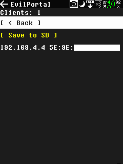
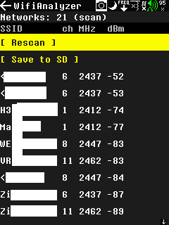
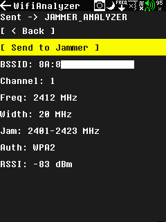

# ESP32-Portapack (ESP32PP)
An addon module for Portapack H4 / PortaRF to add GPS and extra sensors to it for more fun. (H2 too, but needs HW mod)

> ⚠️ **This fork adds WiFi security-testing apps (EvilPortal, WiFi Analyzer, Probe Sniffer, handshake/PMKID capture).**
> They are for **authorized penetration testing and security-awareness use only** — only on networks and devices you own or have **written permission** to test. Unauthorized use may be illegal, and operating a jammer is prohibited in NL/EU regardless of consent. See **[DISCLAIMER.md](DISCLAIMER.md)**. No warranty; use at your own risk.

**This module is in early development. Suggest features via Issues, even for this module, even for the PortaPack (HackRf) part.**

## How to build one for yourself, or other questions? Check WIKI!
If you got the MDK hardware, it has a different pinout, so check the corresponding wiki page for that! Also download the right binary!

### Features:

- **Web interface** with remote control
- **GPS**
- **Compass**
- **Temperature + humidity + pressure + light**
- Portapack / PortaRF I2C interface support! Can add unique apps to PortaX!
- On system apps! The ESP can handle it's own apps built into it. For example Wifi SSID spoofer. (see [Wiki](https://github.com/htotoo/ESP32-Portapack/wiki/On-system-apps) for it)

For detailed info check Wiki

### Features not yet ready: 

- **IR blaster**
  - To add IR remote functions to PP. May be available only over I2C connection. Now only experimental RX.

- **LoRa**
  - Meshtastic support. (functions not yet decided for it)

### Standalone apps
The module will supply additional apps for PortaX devices. Check the list in the [Wiki](https://github.com/htotoo/ESP32-Portapack/wiki/Apps-over-I2C)

Suggest in Issues if you get any ideas.

### WiFi / BLE / Drone security apps (this fork)

> ⚠️ **Authorized penetration testing and security-awareness use only** — only on
> networks/devices you own or have **written permission** to test. See
> **[DISCLAIMER.md](DISCLAIMER.md)**. No warranty; use at your own risk.

This fork adds a suite of on-system ESP apps, each available as a PortaPack icon
under **Utilities**. They are driven over I2C from a matching standalone
PortaPack app ([mayhem-mdk](https://github.com/Xmoo26/mayhem-mdk)).

| App | What it does |
|-----|--------------|
| **EvilPortal** | Captive portal with credential capture. Open/WPA2 AP, pick a built-in page or load custom HTML from SD (`WIFI/EvilPortal/html/`). Shows connected clients and captured credentials, each savable to SD. |
| **WiFi Analyzer** | Passive 2.4 GHz scan: per network SSID, channel, exact center frequency, RSSI, auth. **Channel-usage graph** (APs per channel, 1/6/11 highlighted) and **Send to Jammer** — writes the channel's range to `FREQMAN/` for the PortaPack jammer. |
| **Probe Sniffer** | Captures probe requests — which networks nearby devices are looking for (device MAC + requested SSID + RSSI). Save to SD as CSV. |
| **PMKID / Handshake Capture** | Captures WPA2 **PMKID** and full **4-way handshakes** to a `hashcat`-ready `.hc22000` file. Channel lock + optional **deauth trigger** to force a reconnect. Crack offline on a PC. |
| **Deauth** | Standalone deauthentication: scan APs, pick a target, flood deauth to disconnect its clients (disconnect demo). |
| **BLE Scanner** | Lists nearby Bluetooth LE devices (name, vendor, address type, RSSI). **Tracker detection** (AirTag/Tile/SmartTag/FastPair), a **trackers-only filter**, a live **RSSI "find it" meter**, and CSV export. |
| **BLE Spam** | Broadcasts fake pairing beacons (Apple popup / Google Fast Pair / Microsoft Swift Pair). Build your own sets as hex in `BLUETOOTH/BLESPAM/`. |
| **Drone Detector** | Detects drones three ways: WiFi maker (OUI/SSID), **Open Drone ID / Remote ID** over BLE and WiFi (ID + drone & pilot position), and a **HackRF band bridge** that writes the common drone bands to `FREQMAN/` for spectrum inspection. |

**SD card layout:** custom content and saved data live under `WIFI/` (EvilPortal
pages, saved clients/captures) and `BLUETOOTH/BLESPAM/` (custom spam sets). See
the `README.md` in each folder for the file formats.

> Note: the ESP32-S3 has a **2.4 GHz-only** radio, so the WiFi tools do not see
> 5 GHz networks.

#### EvilPortal

 

#### WiFi Analyzer

 

The selected range loaded straight into the PortaPack jammer via **Send to Jammer**:

More screenshots in [`ScreenShots/evilportal/`](ScreenShots/evilportal) and [`ScreenShots/wifi-analyzer/`](ScreenShots/wifi-analyzer).

### Screenshots:
**ADS-B with location**

  

**ExtSensor app**

**Fox hunt app**

**SatTrack**

**Web app**

### More info
You can get more info in the [Wiki page](https://github.com/htotoo/ESP32-Portapack/wiki). Like, what modules are supported, functions with details. How to build and wire the module. How to flash it. How to start using it.
 

### Support
- Links are affiliate links! If you don't want to use them, feel free to just search for the modules yourself. Using the affiliate links gives me some credits, so I can buy and integrate more modules to this (or other) projects.
- This FW will be always open source and free to use all functions!
